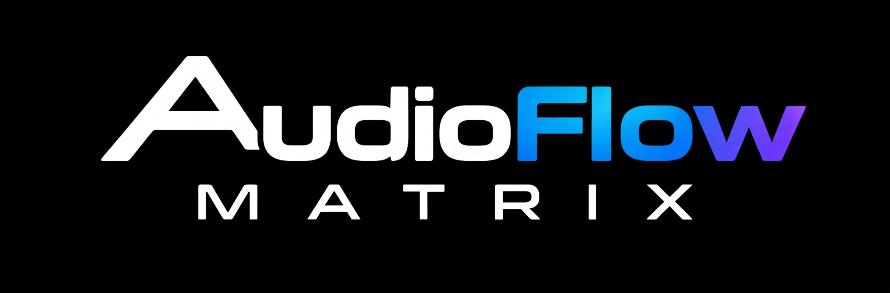

<h1 align="center"></h1>

**Español** · [English](README.en.md)

Router de audio de baja latencia para Windows. Una interfaz ASIO maestra marca el reloj;
Traktor y los DAWs (a través de un driver ASIO virtual), un micrófono USB y una salida
para Discord/OBS se sincronizan con ella mediante colas lock-free y resamplers que
compensan la deriva de reloj.

```
Focusrite (ASIO, reloj maestro) ──┐                  ┌──> Salidas de la Focusrite
Traktor / DAW (ASIO virtual) ─────┼──> matriz NxM ───┼──> Entradas de Traktor (timecode DVS)
Micro USB (WASAPI exclusivo) ─────┘     (AVX2)       └──> Discord / OBS (WASAPI)
```

## Uso

1. Descarga `AudioFlowMatrix.zip` desde [Releases](https://github.com/SubielaDev/AudioFlowMatrix/releases)
   y descomprime `AudioFlowMatrix.exe` y `AudioFlowMatrixASIO.dll` en la misma carpeta.
2. Abre `AudioFlowMatrix.exe` y ve a la pestaña **Devices**:
   - elige el driver ASIO maestro (p. ej. *Focusrite USB ASIO*) y la frecuencia de muestreo;
   - pulsa una vez **Register driver (administrator)**, que instala "AudioFlow Matrix ASIO";
   - opcionalmente activa el micro USB y la salida de stream (para Discord/OBS usa un cable
     virtual como VB-CABLE: envía el audio a *CABLE Input* y elige *CABLE Output* como micro allí).
3. Pulsa **Start**. En Traktor: *Preferences > Audio Setup > AudioFlow Matrix ASIO*.
4. Pestaña **Matrix**: clic en una celda para rutear, clic derecho para ganancia / mute / paneo.
   Pestaña **Mixer**: faders de entrada y de bus de salida con medidores de pico.

Los ajustes se guardan en `%APPDATA%\AudioFlowMatrix\settings.ini`.
`AudioFlowMatrix.exe --list` muestra los dispositivos ASIO y WASAPI detectados.

Para probarlo paso a paso, consulta la [guía de prueba](docs/guia-de-prueba.md).

## Latencia

| Ruta | Latencia que añade AudioFlow Matrix |
|---|---|
| Entrada ASIO → matriz → salida ASIO | 0 (mismo callback) |
| Traktor ↔ matriz | 1 bloque (p. ej. 64 muestras = 1,33 ms a 48 kHz) |
| Micro USB → matriz | Periodo WASAPI + ~1,5 bloques de margen en la cola |

En el hilo de audio el motor no reserva memoria, no usa locks y es `noexcept`.

## Estructura

```
src/core      colas SPSC lock-free (en heap y en memoria compartida), triple buffer, memoria alineada
src/dsp       mezclador matricial AVX2/FMA (elegido en tiempo de ejecución), resampler cúbico + lazo PI
src/engine    AudioEngine (bus, process, telemetría), RoutingModel (dB/mute/paneo)
src/platform  utilidades Win32: puntero COM, MMCSS, UTF-8
src/asio      ABI de ASIO, host del driver maestro, DLL del driver virtual + puente de memoria compartida
src/wasapi    endpoints WASAPI de captura y reproducción (exclusivo con fallback a compartido)
src/app       interfaz Dear ImGui (Win32 + OpenGL 3)
tests         unitarios, estrés multihilo, SIMD contra referencia, simulación de deriva
third_party   Dear ImGui 1.91.8 (MIT)
```

La ABI de ASIO está declarada de forma independiente en `src/asio/include/afm/asio/AsioAbi.h`,
así que no hace falta el SDK de Steinberg para compilar. "ASIO" es una marca registrada de
Steinberg Media Technologies.

## Compilar

Visual Studio 2022 + CMake 3.25 o superior:

```
cmake --preset msvc-x64
cmake --build --preset release
ctest --preset release
```

También funciona cualquier toolchain MinGW con Clang/GCC (incluido `zig c++`) con el generador Ninja.

## Licencia

MIT, ver [LICENSE](LICENSE). Dear ImGui tiene licencia MIT de Omar Cornut.
